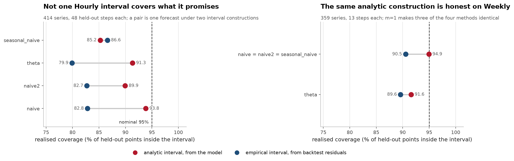
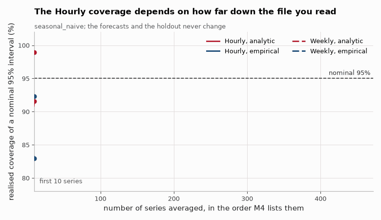
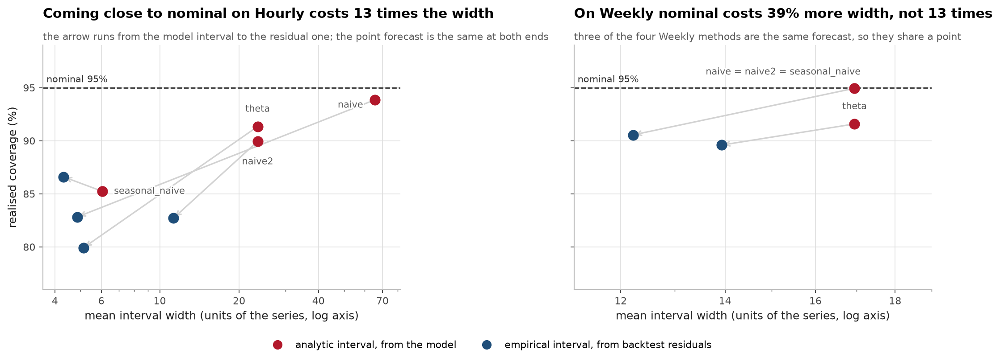
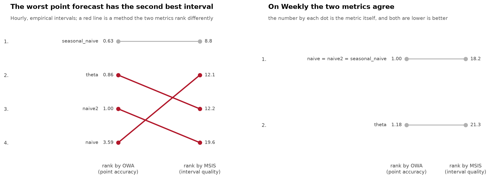
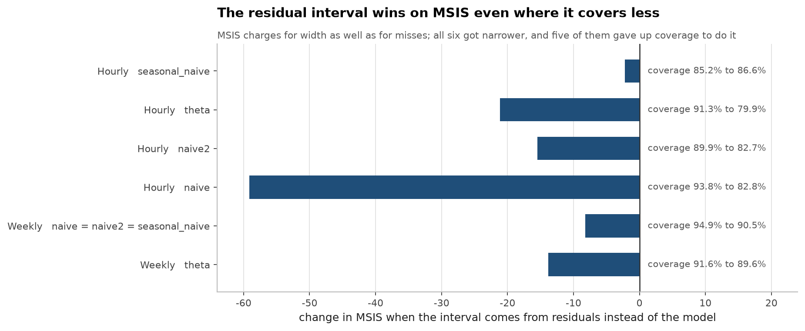
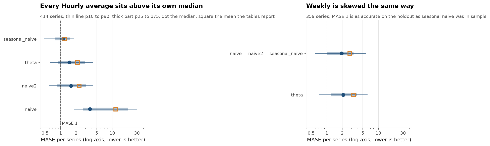

# Forecasting, the interval is the forecast, and mine were wrong

[](https://github.com/aghasalim/m4-forecasting/actions/workflows/ci.yml)
[](https://www.python.org/)
[](LICENSE)
[](https://doi.org/10.5281/zenodo.23003660)

Forecasting on the [M4 competition](https://github.com/Mcompetitions/M4-methods)
benchmark, using 414 Hourly and 359 Weekly series. I scored everything on M4's own
holdout so the numbers can be compared with published work.
The programs under `verify/` rebuild every figure below from the per-series output
files. They're written in other languages and share no code with the pipeline, and
if they disagree the build goes red.

I got interested in this because nobody staffs a warehouse against the mean. They
staff against the upper bound. So I cared most about the prediction interval and
treated point accuracy as the easy part. If a nominal 95% interval only covers 85%
of the time, it's wrong, and sMAPE won't tell you.

---

## Abstract

M4 is scored on point accuracy, and people often treat the interval as an
afterthought. I flipped that around. I ran the same four baseline methods on the
Hourly and Weekly subsets with two ways of building the interval. Then I checked
whether a nominal 95% interval really holds the truth 95% of the time.

Mostly it doesn't. Weekly analytic intervals land on 94.9% for three of the
four methods, which is basically nominal. Everything on Hourly under-covers. The
worst case 79.9% against a nominal 95% is a 15-point shortfall, on an interval
someone would take at face value. Empirical intervals under-cover on Weekly too,
but they get their coverage much more cheaply. On Hourly, `seasonal_naive` is the
one method that's both wider and worse. Its analytic interval is 41% wider than its
empirical one and still covers less, 85.2% against 86.6%. For the other three the
analytic interval does cover more. It's also 2 to 13 times wider, and its MSIS is
worse in every case.

Point accuracy and interval quality don't rank the methods the same way either.
OWA and MSIS disagree. So if you pick a method on the competition metric, that says
nothing about how good its intervals are.

In short, I measured coverage against nominal, and compared width with coverage so
that real coverage isn't confused with intervals that are just wide. I found the
point ranking and the interval ranking differ. And I plotted the per-series spread
behind every average, so you can see it before trusting a two-decimal ranking.

---

## 1. Three results

**1. Nothing achieves its nominal coverage on Hourly. The best is 93.9%, and
it is the widest interval on the board.**

Every method here claims a 95% interval. None of them gets there.

| method | interval | coverage (nominal 95%) | width | MSIS |
|---|---|---|---|---|
| naive | analytic | 93.9% | 65.48 | 71.24 |
| theta | analytic | 91.3% | 23.52 | 33.30 |
| naive2 | analytic | 89.9% | 23.52 | 35.07 |
| **seasonal_naive** | **empirical** | **86.6%** | **4.31** | **8.82** |
| seasonal_naive | analytic | 85.2% | 6.06 | 11.06 |
| naive | empirical | 82.8% | 4.87 | 12.10 |
| naive2 | empirical | 82.7% | 11.28 | 19.57 |
| theta | empirical | 79.9% | 5.14 | 12.18 |

The top of that table is sorted by width about as much as by coverage. `naive` gets
closest to nominal, 93.9%, with a width of 65.48. That's fifteen times the narrowest
interval here. This is why I don't trust coverage alone. You can hit any target by
widening the interval until it's useless. MSIS charges for width, and the three
widest rows are the three worst on it, with naive analytic worst of all at
71.24. The bold row is the best MSIS, not the best coverage.

2. It was better to measure my errors than to trust the model. I kept the same
point forecast and tried two ways of putting an interval around it. For
`seasonal_naive`, empirical residual quantiles gave better coverage (86.6% vs 85.2%)
at 29% narrower width, and MSIS drops from 11.06 to 8.82. The analytic band assumes
the residuals are Gaussian and the model is correctly specified. Neither is true
here, and both push the same way.

3. The plain seasonal naive baseline won. On Hourly, `seasonal_naive`
takes an **OWA of 0.628**, with the best point accuracy and the best intervals.
Theta won M3, and here it scores **0.859**. That's better than the naive2 baseline
it's measured against, but well behind the seasonal naive. On Weekly there's no
season to use, and theta is worse than naive2, at 1.178.

I use M4's definition of OWA. You take the method's mean sMAPE over Naive2's mean
sMAPE, and its mean MASE over Naive2's mean MASE, and average the two. An earlier
version of this README averaged a per series OWA instead. That gave 0.843 and 1.013
and made theta look worse than naive2 on Hourly. I'd aggregated it wrong, and once I
fixed it the theta result flipped.

Naive2 also follows M4. It runs a 90% autocorrelation test for seasonality at lag m.
For the series that pass, it does a classical multiplicative decomposition, a naive
forecast of the adjusted series, and then puts the season back. On Hourly it matches
the sMAPE of 18.383 and MASE of 2.395 that M4 published for Naive2. My first
version skipped the test and used raw seasonal means, which gave 17.36 and 2.27.

| Hourly | sMAPE | MASE | OWA |
|---|---|---|---|
| **seasonal_naive** | **13.91** | **1.19** | **0.628** |
| theta | 15.41 | 2.11 | 0.859 |
| naive2 (baseline) | 18.38 | 2.40 | 1.000 |
| naive | 43.00 | 11.61 | 3.593 |

---





*Coverage as more series are averaged in, on the same seasonal_naive
forecasts and the same M4 holdout. Each line ends on the coverage quoted in the
first table, well short of the nominal 95%.*









Each number in the tables above is a mean over hundreds of series. The last figure
shows the spread behind them. The distributions overlap a lot, so I wouldn't read
a two-decimal ranking as settled.

## 2. The bug, which is the point of the tests

My first empirical intervals covered 44 to 49% on a nominal 95%. Once I saw why, it
was obvious. I'd estimated the 2.5% and 97.5% quantiles from three backtest folds.
A tail quantile of three numbers can't go past their min and max, so my "95%
interval" was really closer to a 50% one.

I'm writing it down because it passed every test I had. My tests checked that the
maths ran, and none of them checked whether an interval covered anything. Now the
fold count comes from the available history (up to 24). Below a floor of 12 I don't
trust tail quantiles at all, and it falls back to a Gaussian scaling of the same
residuals. That still uses them but doesn't pretend to know their tails.
`tests/test_fc.py` now checks end-to-end coverage, which would have caught it.

---

## 3. Limitations

- Weekly has no seasonality in M4's setup (`m=1`), so `naive`, `naive2` and
`seasonal_naive` give the same forecast there and report identical numbers.
  That's the correct behaviour, and it's why the Weekly table looks
  odd.

I compute OWA against my own Naive2. On Hourly its sMAPE and MASE match M4's
published Naive2 values to three decimals. I haven't compared the other methods
with the published leaderboard, though, so any ranking only holds inside this repo.

I only used two of the six frequencies. Hourly and Weekly are 773 of M4's 100,000
series. I picked them because Hourly is strongly seasonal and Weekly isn't. Monthly
and Quarterly make up most of the real benchmark, and they're not here.

There are no ML models, only statistical baselines. M4 found that pure ML did worse
than statistical methods. Testing that myself would be the next step, and I haven't
done it yet.

One more thing. The Weekly analytic interval for `seasonal_naive` is well calibrated
(94.9% against 95%), but its Hourly one isn't (85.2%). It's the same method built
the same way, and it's fine on one frequency and off on the other. That's why I think
coverage has to be measured per dataset.

## 4. Running it

```bash
make setup && make test
```

```bash
make data && make backtest
```

The data comes from the public
[M4-methods](https://github.com/Mcompetitions/M4-methods) repository. You don't need
credentials or API keys.

## 5. Licence

MIT. M4 data © the M4 competition organisers.

## References

These are the sources the code relies on, and what I took from each.

- **Makridakis, Spiliotis, Assimakopoulos. The M4 Competition: 100,000 time series and 61 forecasting methods. International Journal of Forecasting 36, 2020.** the dataset, the Naive2 benchmark and the OWA metric.
- **Hyndman, Koehler. Another look at measures of forecast accuracy. International Journal of Forecasting 22, 2006.** MASE.
- **Assimakopoulos, Nikolopoulos. The theta model. International Journal of Forecasting 16, 2000.** the Theta method.
